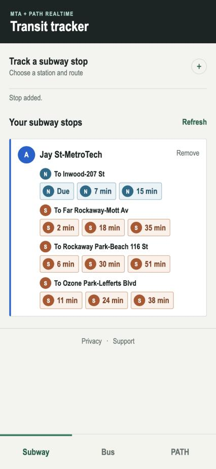
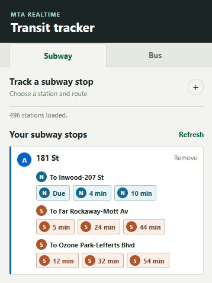

# NYC Transit Tracker

Live arrival times and service alerts for the NYC subway, MTA buses and PATH trains, for just the stops you care about. Save your stops once, then check them at a glance.

It comes in two forms that work the same way:

| | Best for | Get it |
|---|---|---|
| **Web app** | Your phone on the go, or any browser | [nyc-transit-tracker.iamintisar45.workers.dev](https://nyc-transit-tracker.iamintisar45.workers.dev/) |
| **Chrome extension** | Your laptop or desktop at work | [Chrome Web Store](https://chromewebstore.google.com/detail/jbafnppnbgdaonfipcolgmhplifahhln) |

Both are free, need no account, and show no ads.

<p>
  
  &nbsp;&nbsp;
  
</p>

## What it does

- **Subway, bus and PATH** in separate tabs.
- **Save the stops you use.** Search for a station or bus stop and pick a route (or, for PATH, a direction). You can save as many as you like.
- **Live arrivals** for each saved stop, grouped by direction and destination, showing the next few trains or buses in minutes.
- **Service alerts** for your route at that stop. Cards with an alert are highlighted, and you can tap the alert to read the details. PATH alerts (delays, elevator outages, travel advisories) cover the whole system, so they appear together at the top of the PATH tab.
- **Updates on its own** every 30 seconds while it's open, or tap **Refresh** any time.

## Use it on your phone

1. Open [nyc-transit-tracker.iamintisar45.workers.dev](https://nyc-transit-tracker.iamintisar45.workers.dev/) in your phone's browser.
2. Add it to your home screen so it opens like an app:
   - **iPhone:** in Safari, tap the **Share** button, then **Add to Home Screen**.
   - **Android:** in Chrome, tap the **⋮** menu, then **Install app** or **Add to Home screen**.
3. Open it from the new icon, choose a tab, and tap **Track a … stop** to add your first stop.

## Use it on your computer

Install the extension from the [Chrome Web Store](https://chromewebstore.google.com/detail/jbafnppnbgdaonfipcolgmhplifahhln). It works in Chrome and in other browsers that accept Chrome Web Store extensions, such as Microsoft Edge and Brave. Click the extension's icon in the toolbar to open it, then add your stops. You can pin the icon from the browser's puzzle-piece menu.

Prefer not to install anything? The web app works in any desktop browser too.

## Good to know

- **Your saved stops stay on your device.** They aren't uploaded anywhere, so stops saved on your laptop won't appear on your phone. Add them on each device you use.
- **PATH times come from an unofficial source.** The Port Authority doesn't offer an official live data feed, so the PATH tab reads the data behind its website. PATH alerts come from the same website. Either can occasionally be unavailable; the app will say so when it is.
- **Times are predictions** from the MTA and Port Authority and can change, especially during service disruptions.
- **Privacy:** no tracking, analytics or personal data. See the [privacy policy](./PRIVACY.md) for details.

## Help and feedback

Found a bug, see wrong arrivals, or have an idea? [Open an issue on GitHub](https://github.com/Al-Ashir-Intisar/NYCSubwayTracker/issues). The **Support** link at the bottom of the app goes to the same place.

---

## For developers

This repository holds both versions. They share the same app code; the differences come from how each one is hosted:

- The **web app** is hosted on [Cloudflare Workers](https://developers.cloudflare.com/workers/). A small Worker serves the app and also acts as a go-between for the transit feeds, because websites, unlike extensions, aren't allowed to request those feeds directly. It caches each feed for 20 seconds so many users share one download.
- The **Chrome extension** runs in the browser's popup. It downloads the subway and PATH feeds directly, and gets bus data from the same Worker.

Bus data needs an MTA Bus Time API key, and only the Worker holds it, so the key never ships to anyone's device.

You're welcome to fork it, run your own copy, or adapt it for another city ([MIT license](./LICENSE)).

### What you'll need

- [Node.js](https://nodejs.org/) 20 or newer.
- A free **MTA Bus Time API key** for bus arrivals, from [register.developer.obanyc.com](https://register.developer.obanyc.com/). Subway and PATH data need no key.
- A free [Cloudflare account](https://dash.cloudflare.com/sign-up) to publish your own Worker. Both versions get bus data from it.

Then install the dependencies and add your key to a file named `.dev.vars` in the project folder, which the Worker uses when it runs on your computer. This file is ignored by Git, so it won't be committed.

```bash
npm install
```

```
MTA_BUS_API_KEY=your-key
```

### Run the extension yourself

1. Build it with `npm run build:extension`.
2. In Chrome, open `chrome://extensions`, turn on **Developer mode**, choose **Load unpacked**, and select this project folder.
3. After changing the code, run the build again and click the reload button on the extension's card.
4. To publish a new version, raise `version` in `manifest.json` (and `package.json`), then run `npm run package:extension`. It creates `dist/nyc-transit-tracker-<version>.zip` with only the files the extension needs, ready to upload to the Chrome Web Store. Don't zip the project folder yourself: the store needs `manifest.json` at the top of the zip, and the folder also holds your key file and other private files.

The extension's bus tab uses the Worker published from this repository. To use your own, publish the web app (below), then put its address in `WORKER_ORIGIN` in [src/platform/extension.js](./src/platform/extension.js) and in the last `host_permissions` entry in `manifest.json`.

### Run the web app yourself

1. Run `npm run dev` and open <http://localhost:8787>. This runs the app and the Worker together on your computer, using the key from `.dev.vars`.
2. To publish it, log in to Cloudflare once, publish, then store your bus key on Cloudflare (it asks you to paste the key):

   ```bash
   npx wrangler login
   ```

   ```bash
   npm run deploy
   ```

   ```bash
   npx wrangler secret put MTA_BUS_API_KEY
   ```

   Your app will be at `https://nyc-transit-tracker.<your-subdomain>.workers.dev`. Change `name` in [wrangler.jsonc](./wrangler.jsonc) to pick a different address.
3. To update it later, run `npm run deploy` again. Phones pick up the new version the next time the app is opened.

Cloudflare's free plan allows 100,000 requests to the Worker per day, which covers a few hundred hours of combined use. Cloudflare's [Workers pricing](https://developers.cloudflare.com/workers/platform/pricing/) has the details if you need more.

### How the project is organized

| Path | What's in it |
|---|---|
| `popup.html`, `popup.css`, `src/popup.js` | The app itself, shared by both versions |
| `src/path.js` | PATH stations and arrival parsing |
| `src/platform/` | The few places the two versions differ: where saved stops are stored and how feeds are reached |
| `web/` | Web-app-only files: phone layout styles, offline support, home screen icon and app details |
| `worker/index.js` | The Cloudflare Worker that serves the web app and relays the transit feeds |
| `manifest.json` | The Chrome extension's settings and permissions |
| `gtfs_subway/`, `gtfs_bus/` | Station, stop and route lists, plus the list of live feeds the app uses |
| `scripts/build.mjs` | Builds both versions (`npm run build`, or `build:extension` / `build:web`) |

### Where the data comes from

- **Subway:** the MTA's public [GTFS-realtime feeds](https://api.mta.info/) for arrivals and service alerts.
- **Bus:** [MTA Bus Time](https://bustime.mta.info/wiki/Developers/Index), through the Worker. Arrivals are requested one stop at a time to keep data use low.
- **PATH:** the unofficial data behind the schedule and alerts pages on [panynj.gov](https://www.panynj.gov/path/en/index.html). The alerts are free-text messages from the last 8 hours with no station or line tags, so the app shows them for the whole system rather than per station. Both could change or disappear without notice.

The station and stop lists in `gtfs_subway/` and `gtfs_bus/` come from the MTA's static schedule data. The MTA updates bus schedules about every three months. When it does, refresh `gtfs_bus/routes.txt` and `gtfs_bus/stops.txt` from the [MTA's published feeds](https://new.mta.info/developers) so new stops and routes show up.

### Things to watch out for

- Wrangler (Cloudflare's command-line tool) is pinned to version 4.86.0 because newer versions need Node.js 22. If you use Node.js 22 or newer, you can upgrade it.
- The web app's icons are generated by `scripts/make-icons.mjs`. Replace the images in `web/icons/` to use your own.
