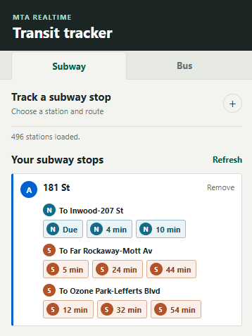

# NYC Transit Tracker

A Chrome extension for tracking realtime arrival predictions for selected NYC subway and bus routes and stops.

## Run the extension

1. Install dependencies with `npm install`.
2. Add your MTA Bus Time API key to the ignored `.dev.vars` file as `MTA_BUS_API_KEY=your-key` (the extension ID is no longer needed).
3. Build the extension with `npm run build`.
4. In Chrome, open `chrome://extensions`, enable Developer mode, and choose **Load unpacked**. Select this repository directory.
5. Use the separate Subway and Bus tabs to choose a station/stop and route, then add it to that mode's tracked list.

## Features

- Use separate Subway and Bus tabs, each with its own stop search, route search, saved stops, and arrival results.
- Search subway stations or bus stops and routes with relevance-ranked fuzzy matching, then save the combinations you want to track.
- View realtime arrival predictions grouped by direction and destination.
- See active service alerts matching each saved route and station/stop. Alerted cards are highlighted; expand an alert to read its description.
- Refresh arrivals and service alerts every 15 seconds while the popup is open. Saved stops are stored in your browser.

The extension uses subway feeds from `gtfs_subway/realtime_feed_apis.txt` and `gtfs_subway/service_alert_feeds.txt`. Bus route/stop lookup tables in `gtfs_bus/` are compiled from the six public MTA bus GTFS feeds. Bus realtime requests go directly to the MTA Bus Time API.

### Bus API key

The build reads `MTA_BUS_API_KEY` from the ignored local `.dev.vars` file and writes the bus feed URLs to ignored `dist/bus-config.js`. The key is not committed, but it is visible to anyone who can inspect or copy a built extension. Do not commit or share the generated `dist/` directory if you want to keep using this key privately. Rebuild after changing the key.

Only transit modes with saved station/route combinations are refreshed. If you track subway stops only, the extension requests subway feeds only; bus feeds are fetched only when bus stops are tracked. Refresh runs every 15 seconds while the popup is open and at least one stop is tracked. MTA bus static GTFS data is published quarterly; refresh `gtfs_bus/routes.txt` and `gtfs_bus/stops.txt` from the six official feeds when MTA updates those schedules.

## How It Looks

